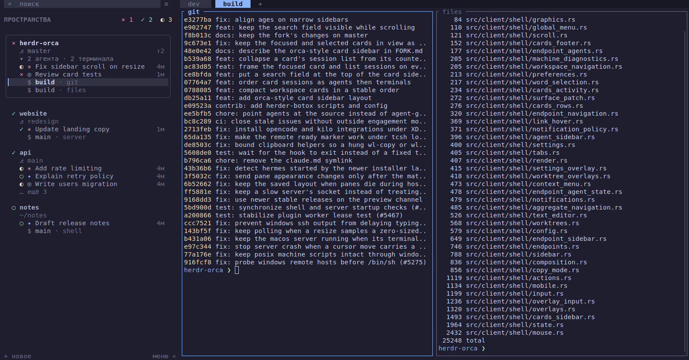

# herdr-orca

Форк [herdr](https://github.com/herdrdev/herdr) с левой панелью в духе
[Orca](https://github.com/stablyai/orca). herdr остаётся терминальным
приложением; меняется только боковая панель, и только если её включить.

Ветка `master` — наши изменения поверх `master` апстрима.

## Что добавлено

### Карточная боковая панель (`[ui.sidebar] layout = "cards"`)

Вместо двух блоков «spaces» и «agents» — один список карточек рабочих
пространств, как в Orca. У каждой карточки видны её сессии: агенты (статус,
вид агента, чем занят, сколько времени в статусе) и обычные терминалы.
Текущее пространство — в рамке, со всеми сессиями.



- **Строка карточки**: статус главного агента и имя; ветка с `↑N ↓M` (нет
  ветки — путь); у текущей — счётчик `▾ 2 агента · 2 терминала`.
- **Сессии**: сначала агенты, потом терминалы, в порядке вкладок и панелей.
  Значок вида агента: claude `✳`, codex `◎`, gemini `✦`, opencode `■`,
  cursor `▲`, copilot `◈`, остальные `◆`. Терминал — `$ вкладка · панель`.
  Текущая панель подсвечена полосой `▎`.
- **Порядок не прыгает**: карточки и строки стоят на месте, когда агент
  меняет статус.
- **Неактивные карточки** показывают первые `inactive_rows` сессий (по
  умолчанию 3), остальное — строкой «… ещё N». Текущая показывает всё, что
  помещается; если не помещается — окно вокруг текущей панели и «… ещё N».
- **Свернуть сессии**: клик по счётчику `▾` текущей карточки. Свёрнутая
  карточка, пока она неактивна, — только имя и ветка. Запоминается.
- **Время в статусе** (`2м`, `5м`, `1ч`): считает клиент с момента, когда
  увидел смену статуса, и помнит между переподключениями.
- **Счётчики** справа от заголовка: сколько агентов ждёт, готово, работает.
  Клик — к следующему агенту в этом статусе.
- **Поиск**: поле вверху или `/` в режиме навигации (`prefix` + `w`). Ищет по
  имени, ветке, репозиторию, вкладкам, панелям, агентам и их заголовкам;
  совпавшие сессии карточки встают первыми. `Enter` — оставить, `Esc` —
  сбросить.
- **Закреплённые (Pinned)**: ПКМ по карточке → `Pin` / `Unpin`. Закреплённые
  всегда сверху.
- **Группировка по репозиторию**: кнопка `≡`. Секции сворачиваются кликом
  (карточка текущего пространства остаётся видна). Запоминается.
- **Перетаскивание** карточек меняет порядок пространств (в плоском списке без
  фильтра; закреплённые не перетаскиваются).
- **Лимиты внизу панели**: `footer_command` — любая команда, первая строка её
  вывода показывается внизу (например, `herdr-limits.sh` из herder-botox).
- `↑/↓` в режиме навигации и переключение пространств идут в порядке карточек.

| Где | Что делает |
|-----|-----------|
| Имя, ветка, «… ещё N» | перейти в пространство |
| Счётчик `▾` / `▸` | свернуть / развернуть сессии карточки |
| Строка агента или терминала | перейти в эту панель |
| ПКМ по строке сессии | меню панели |
| ПКМ по карточке | меню пространства (Pin/Unpin и т. д.) |

Свёрнутая панель, мобильная раскладка и режим с несколькими машинами остаются
прежними.

Настройки:

```toml
[ui.sidebar]
layout = "cards"            # "panels" — как в оригинальном herdr

[ui.sidebar.cards]
group_by = "none"           # none | project
card_gap = 1                # пустых строк между карточками
inactive_rows = 3           # строк сессий у неактивных карточек (0 — ни одной)
footer_command = "$HOME/herder-botox/bin/herdr-limits.sh"
footer_interval_seconds = 30

# Подписи (ключи: title, search, blocked, done, working, idle, no_repo, new,
# menu, empty, no_matches, now, minutes, hours, days, more, agents_one,
# agents_few, agents_many, terminals_one, terminals_few, terminals_many).
# one/few/many — формы для 1, 2–4 и 5+. Пустое значение — по умолчанию.
[ui.sidebar.cards.labels]
title = "пространства"
search = "поиск"
blocked = "ждёт"
more = "ещё"
agents_one = "агент"
agents_few = "агента"
agents_many = "агентов"
terminals_one = "терминал"
terminals_few = "терминала"
terminals_many = "терминалов"
minutes = "м"
```

Готовый фрагмент: [`contrib/herder-botox/config/herdr-orca-cards.toml`](contrib/herder-botox/config/herdr-orca-cards.toml).

### contrib/herder-botox

Наши скрипты и конфиг для herdr (статус агентов, контекст, лимиты, прокси,
копирование имени вкладки). См. [`contrib/herder-botox/README.md`](contrib/herder-botox/README.md).
Работают и со стоковым herdr.

## Сборка

Нужны Rust из `rust-toolchain.toml` и Zig 0.16.0 (для вендорного libghostty-vt).

```sh
ZIG=/path/to/zig-0.16.0/zig cargo build --release
cp target/release/herdr ~/.local/bin/herdr   # заменить установленный
herdr server stop                            # чтобы сервер поднялся новым бинарём
```

## Обновление из апстрима

```sh
git remote add upstream https://github.com/herdrdev/herdr   # один раз
git fetch upstream
git merge upstream/master
```

Или кнопкой **Sync fork** на странице форка, если обновление не
конфликтует с нашими изменениями. Сливаем, а не перебазируем: `master`
опубликован, и rebase потребовал бы перезаписать его на GitHub. При
конфликте git остановится: поправить файлы, затем `git add` и `git commit`.

`README.md` у форка свой, а апстрим переписывает его к каждому релизу, так
что конфликт в нём ожидаем. Оставить нашу версию:

```sh
git checkout --ours README.md && git add README.md
```
