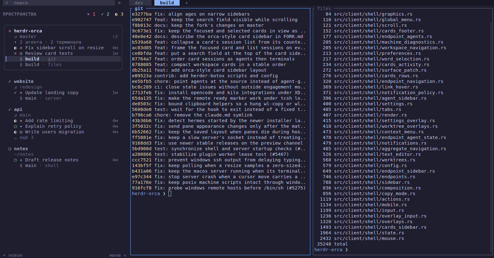
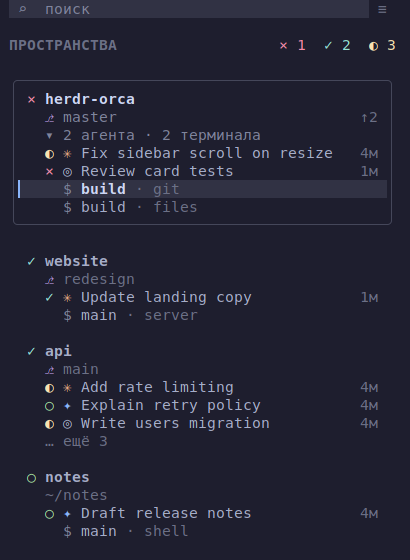
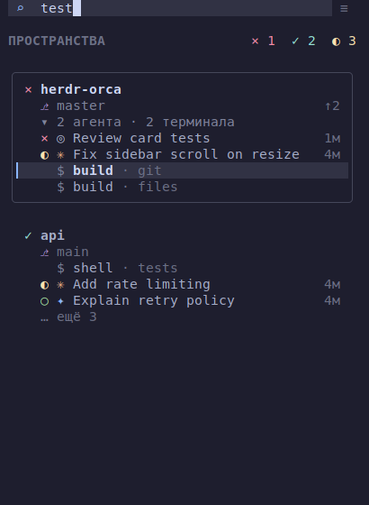

# herdr-orca

Форк [herdr](https://github.com/herdrdev/herdr) с боковой панелью в духе
[Orca](https://github.com/stablyai/orca).

herdr — терминальное приложение для код-агентов: держит терминалы и агентов
(Claude Code, Codex, Gemini и других) в фоновом сервере и показывает, кто
работает, кто ждёт ответа, а кто закончил. В форке поменялась только левая
панель, всё остальное — обычный herdr.

## Как выглядит



| Панель крупно | Поиск «test» |
|:---:|:---:|
|  |  |

Слева — пространства, обычно одно на проект. У каждого видны его сессии:
сначала агенты, потом обычные терминалы.

- Текущее пространство обведено рамкой и показывает все сессии. Текущая
  панель подсвечена полосой `▎`.
- У остальных — первые три сессии и строка «… ещё N».
- Под именем — ветка git и сколько коммитов не отправлено (`↑2`).
- Статус агента: `×` ждёт ответа, `◐` работает, `✓` готово, `○` простаивает.
  Справа — сколько времени он в этом статусе.
- Вид агента: claude `✳`, codex `◎`, gemini `✦`, opencode `■`.
- Наверху — сколько агентов в каждом статусе. Клик ведёт к следующему из них.
- **Поиск** находит пространства и сессии по имени, ветке, вкладке, агенту и
  тому, чем он занят. Совпавшие сессии встают первыми.

Мышью: клик по сессии — перейти в эту панель, правый клик — меню панели,
клик по `▾ 2 агента · 2 терминала` — свернуть список. Карточки можно
перетаскивать и закреплять (правый клик → Pin).

## Как установить

Готовых сборок нет, собирается из исходников. Нужны:

- Rust через [rustup](https://rustup.rs) — версию из `rust-toolchain.toml`
  он поставит сам при первой сборке;
- [Zig 0.16.0](https://ziglang.org/download/) — архив достаточно распаковать.

```sh
git clone https://github.com/1mprover/herdr-orca
cd herdr-orca
ZIG=/путь/к/zig-0.16.0/zig cargo build --release
cp ~/.local/bin/herdr ~/.local/bin/herdr.bak   # если herdr уже стоял
cp target/release/herdr ~/.local/bin/herdr
```

Включи панель в `~/.config/herdr/config.toml` (если секции `[ui]` или
`[ui.sidebar]` там уже есть, допиши строки в них):

```toml
[ui]
status_indicators = "symbols"   # значки × ◐ ✓ ○ вместо цветных точек

[ui.sidebar]
layout = "cards"
```

Русские подписи, как на скриншотах, — в
[`contrib/herder-botox/config/herdr-orca-cards.toml`](contrib/herder-botox/config/herdr-orca-cards.toml):
скопируй оттуда секцию `[ui.sidebar.cards.labels]`.

Запусти `herdr`. Если он уже был запущен, переподключись: `ctrl+b q`, затем
`herdr` — терминалы и агенты продолжат работать. Если herdr попросит
перезапустить сервер: `herdr server stop` и снова `herdr`. Раскладка
вернётся, но запущенные в терминалах процессы закроются.

Все настройки панели, обновление из оригинального herdr и прочие подробности —
в [FORK.md](FORK.md). Лицензия — Apache-2.0, как у herdr.
